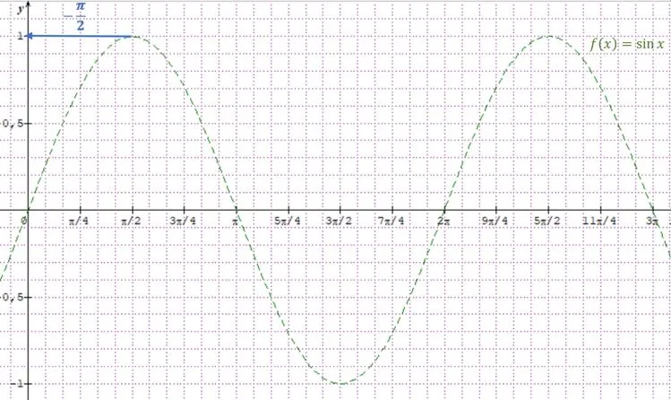

1. Calculer :
   1. $\cos 0$
   2. $\cos \frac{\pi}{2}$
   3. $\cos \pi$
   4. $\sin \left(0+\frac{\pi}{2}\right)$
   5. $\sin \left(\frac{\pi}{2}+\frac{\pi}{2}\right)$
   6. $\sin \left(\pi+\frac{\pi}{2}\right)$

2. Compléter la relation suivante : $\cos x =\sin(\ldots+\ldots)$.

3. En utilisant la relation précédente, compléter le tableau de valeurs de la fonction cosinus sur l'intervalle $[0\,;2\pi]$.

   

4. Tracer la courbe représentative de la fonction cosinus sur l'intervalle $[0\,;2\pi]$ par translation de la courbe représentative de la fonction sinus.

   
