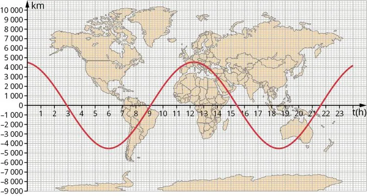

::: ouvrir https://www.youtube.com/watch?v=lTlLmcrrU0A
:::

La trajectoire d'un satellite sur 24 heures, projetée sur un planisphère, est représentée ci-dessous.

1. Quel type de courbe permet de représenter la trajectoire du satellite sur le planisphère ?

2. Estimer la largeur de la bande couverte par le satellite lors de ses multiples passages.

3. À quelle heure le satellite survole-t-il la France ?

4. Combien de fois le satellite traverse-t-il l'équateur au cours de la journée ?
