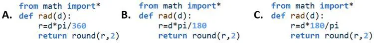

On définit en Python la fonction `rad(d)`, qui a un paramètre : la mesure `d` d'un angle en degrés. La fonction renvoie la mesure de l'angle en radians, arrondie au centième.

1. Parmi les trois scripts suivants, lequel permet de convertir l'angle $d$ en degrés en radians ?

   

2.
   1. Ouvrir et exécuter le programme ci-dessous.

      ::: ouvrir https://console.basthon.fr/?script=eJxLK8rPVchNLMlQyMwtyC8q0eLlSklNUyhKTNFI0bTi5VIAgiLbFK2CTH1DCwMoP7WktChPoSi_NC9Fo0jHSBMiDABTaRSc
      :::

   2. Utiliser le programme pour convertir les angles suivants en radians : 35° ; 73° ; 143°.

3. Procéder par tâtonnements pour trouver la valeur approchée de la mesure en degrés d'un angle de 1 rad.

```python
from math import*
def rad(d):
    r=d*pi/180
    return round(r,2)
```
