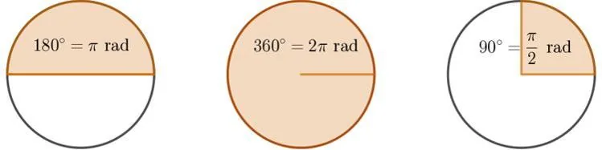
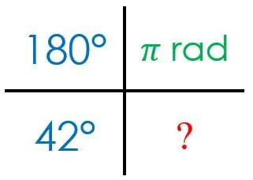

Les mesures en degrés et en radians sont proportionnelles : $180° = \pi\text{ rad}$.

Pour convertir un angle en degrés (°) en radians (rad), on utilise la quatrième proportionnelle.

**Exemple :** convertir 42° en radians.

$\frac{42\times\pi}{180}\approx0{,}73\text{ rad}$

Les angles les plus courants sont souvent écrits sous forme d'une fraction de $\pi$.

**Exemples**

- $180°=\pi\text{ rad}$
- $90°=\frac{\pi}{2}\text{ rad}$
- $60°=\frac{\pi}{3}\text{ rad}$
- $45°=\frac{\pi}{4}\text{ rad}$
- $30°=\frac{\pi}{6}\text{ rad}$
