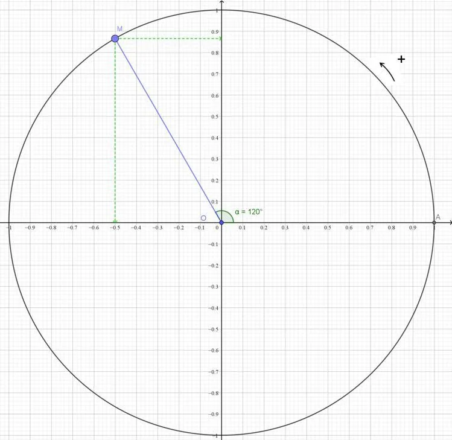

1. Construire un cercle trigonométrique.

2. Placer le point du cercle correspondant à la mesure de l'angle.

3. Lire les coordonnées de ce point.

   - L'abscisse du point correspond au cosinus de l'angle.
   - L'ordonnée du point correspond au sinus de l'angle.

   **Exemple**

   Déterminer graphiquement $\cos(\frac{2\pi}{3})$ et $\sin(\frac{2\pi}{3})$

   - On place le point $M$ tel que $\widehat{AOM}=\frac{2\pi}{3}\text{ rad}=120°$.

   

   - On lit les coordonnées du point $M$ : $\cos(\frac{2\pi}{3})=-0{,}5$ (abscisse du point $M$) et $\sin(\frac{2\pi}{3})\approx0{,}87$ (ordonnée du point $M$).
