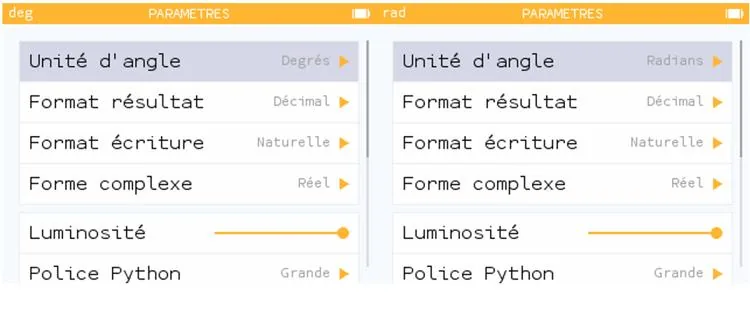
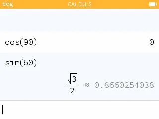
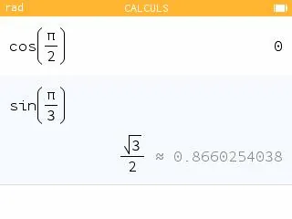

1. Ouvrir NumWorks.

2. Accéder au menu **Paramètres**.

   

3. Régler l'unité d'angle souhaitée : **Degrés** ou **Radians**.

   

4. Accéder au menu **Calculs**.

   - **En degrés :** utiliser les touches **cos** ou **sin** puis taper la valeur de l'angle en degrés.

   

   - **En radians :** utiliser les touches **cos** ou **sin** puis taper la valeur de l'angle en radians.

   
