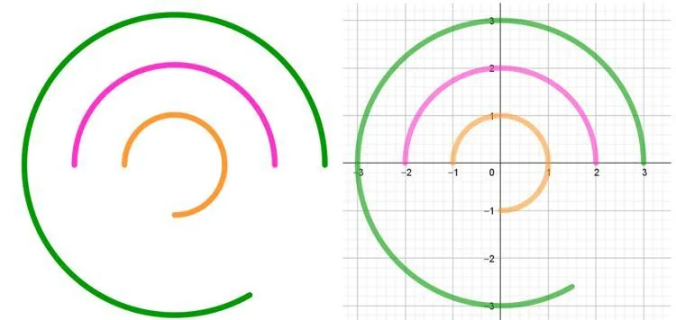

Une entreprise souhaite installer un logo circulaire rétroéclairé sur la façade de son bâtiment. Ce logo est constitué de trois bandes circulaires concentriques, espacées régulièrement d’un mètre. Le rayon total du logo est de 3 mètres et chaque bande doit être équipée de bandes LED pour assurer un bon éclairage.

::: problematique
Quelle est la longueur totale des bandes LED nécessaires au rétroéclairage du logo ?
:::

::: coup-de-pouce x-logo
:::

1. Déterminer l'angle en radians formé par chacune des bandes.

2. Calculer la longueur de chaque bande.

3. Répondre à la problématique par une phrase en justifiant la réponse par un calcul.
