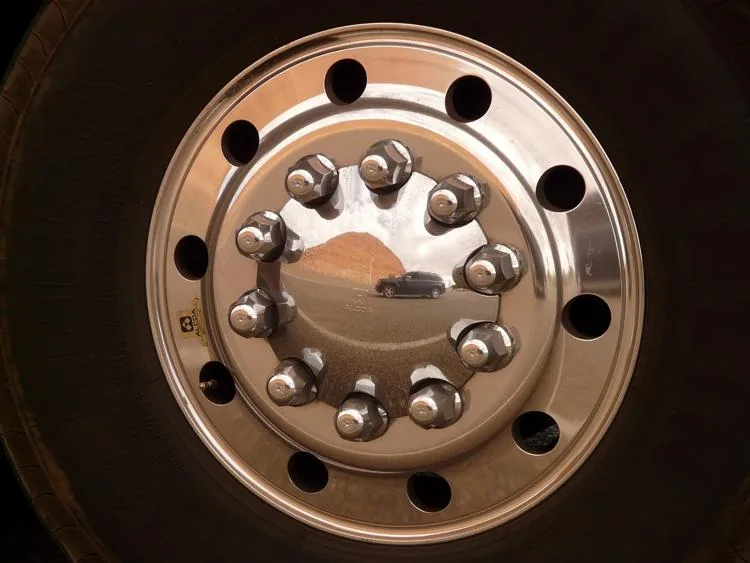

Pour la réalisation du cache-moyeu chromé d'une jante de voiture ancienne, un technicien d'usinage doit percer une pièce métallique de 10 trous régulièrement espacés sur un cercle de 6 cm de rayon centré sur l'origine d'un repère.

Pour programmer la machine à commande numérique, le technicien doit déterminer précisément les coordonnées $(x\,;y)$ du centre de chaque trou dans le repère.

::: problematique
Quelles sont les coordonnées du centre de chacun des 10 trous ?
:::

::: coup-de-pouce x-moyeu
:::

1. Calculer l'angle en degrés entre deux trous consécutifs.

2. Convertir cet angle en radians.

3. Ouvrir le fichier ci-dessous dans un tableur.

   ::: fichier fichiers/cache-moyeu.xlsx
   :::

   - Dans la case C2, saisir la formule qui multiplie le numéro du trou (B2) par l'angle en radians entre deux trous consécutifs.
   - Dans la case D2, saisir la formule qui calcule le cosinus de l'angle.
   - Dans la case E2, saisir la formule qui calcule le sinus de l'angle.
   - Dans la case F2, multiplier le cosinus (D2) par le rayon du cercle.
   - Dans la case G2, multiplier le sinus (E2) par le rayon du cercle.
   - Étendre les formules sur les 10 lignes du tableau.

4. Citer deux trous qui forment des angles opposés.

5. Citer deux trous qui forment des angles supplémentaires.

6. Répondre à la problématique.
