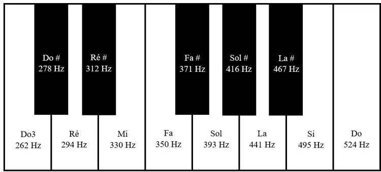

Le son est une vibration mécanique qui se propage dans un milieu matériel, comme l’air. Lorsqu’un objet vibre, il met les particules d’air voisines en mouvement. Ces particules, à leur tour, transmettent l’onde de proche en proche. C’est ainsi que le son se propage sous forme d’ondes jusqu’à notre oreille.

Un accordeur de piano utilise des diapasons pour accorder un piano. Le signal sonore produit par un des diapasons peut être modélisé par la fonction $f(t)=2\sin(2\,764{,}6t)$.

::: problematique
Quelle note du piano peut-il accorder en utilisant ce diapason ?
:::

::: coup-de-pouce x-piano
:::

1. Représenter graphiquement la fonction à l'aide de la calculatrice NumWorks sur l'intervalle $[-0{,}003\,;0{,}003]$.

2. Déterminer graphiquement la période (temps nécessaire pour effectuer une oscillation).
   (Arrondir à $10^{-5}$.)

3. Calculer le nombre d'oscillations effectuées en 1 seconde. (Arrondir à l'unité.)

4. En s'appuyant sur le document suivant, déterminer la note émise par le diapason.

   

5. Répondre à la problématique.
