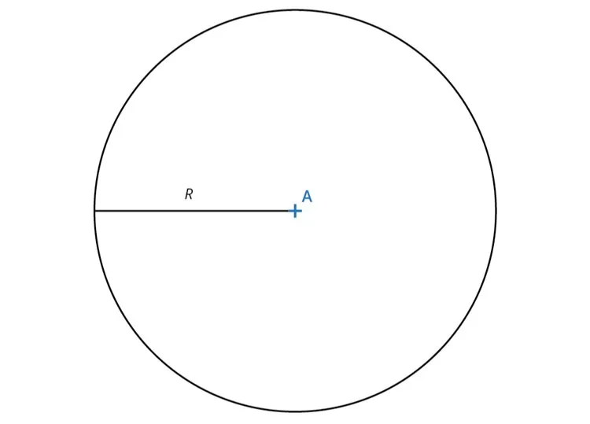

**Principe :** le périmètre d'un disque est la longueur du cercle qui l'entoure.

**Formule :** pour calculer le périmètre d'un disque dont on connaît le rayon $R$, on utilise la formule $P = 2 \times \pi \times R$.

**Exemple :** le périmètre du disque de rayon 9 cm est $P = 2 \times \pi × 9 \approx 56{,}5 \text{ cm}$.
