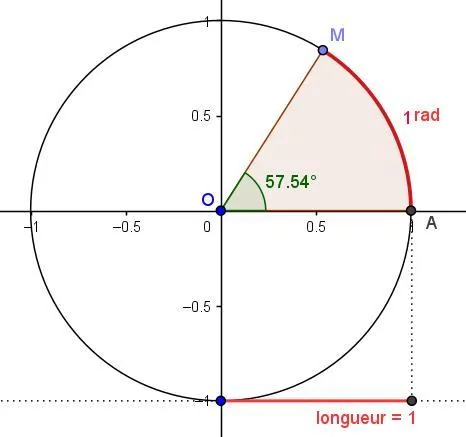

**Définition :** la mesure d'un angle en radians est la distance parcourue sur un cercle de centre $\text{O}$ et de rayon 1.

Les mesures d'un angle en degrés et en radians sont proportionnelles.

**Formule :** ${180° = \pi\text{ rad}}$.
