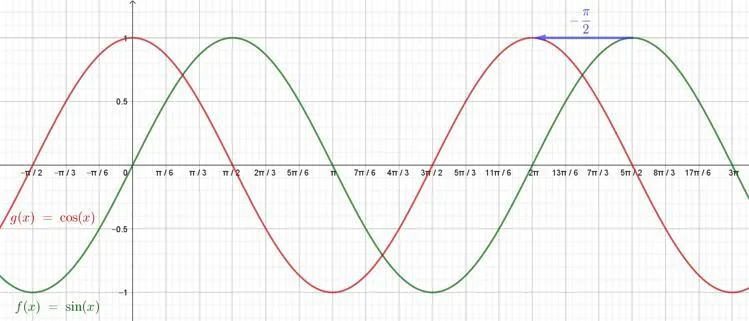

Les fonctions sinus et cosinus sont représentées graphiquement par le même type de courbes, appelées sinusoïdes. Ces deux fonctions ont la même forme, la même amplitude et la même période ($2\pi$). La seule différence est un décalage horizontal (appelé translation).

Cela signifie que la courbe représentative de la fonction cosinus s'obtient par un décalage vers la gauche de la courbe de la fonction sinus de $\frac{\pi}{2}$.

**Formules**

- $\cos(x)=\sin(x+\frac{\pi}{2})$
- $\sin(x)=\cos(x-\frac{\pi}{2})$
