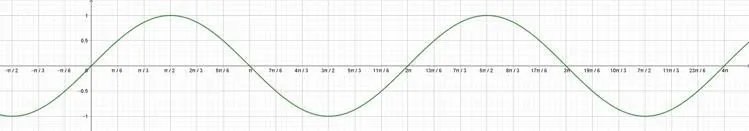

**Définition**

La fonction sinus est une fonction périodique, définie pour tout réel $x$, par : $f(x) = \sin(x)$.

Sa courbe représentative est une sinusoïde. La période de la fonction sinus est $T=2\pi$. Cela signifie que la courbe se répète tous les $2\pi$ radians.

### Modélisation d'un mouvement oscillatoire

Les mouvements oscillatoires peuvent être modélisés par des fonctions sinusoïdales du type : $f(t)=A\times\sin (B\times t)$ où :

- le coefficient $A$ correspond à l'amplitude des oscillations ;
- le coefficient $B$ agit sur la fréquence des oscillations. (Plus $B$ est grand, plus l'oscillation est rapide.)
