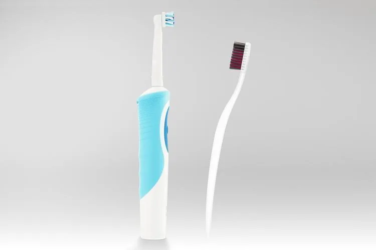
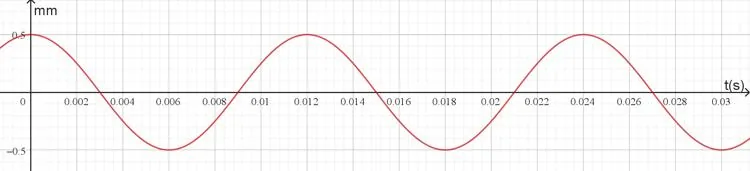

Les dentistes recommandent de se brosser les dents deux fois par jour pendant 2 minutes. Ils conseillent également l’usage d’une brosse à dents électrique qui effectue des mouvements de va-et-vient très rapides.

::: problematique
Pourquoi les dentistes recommandent-ils les brosses à dents électriques ?
:::

Les vibrations d'une brosse à dents électrique sont périodiques et peuvent être modélisées par une fonction donnant la position de la tête de la brosse (en mm) en fonction du temps (en seconde) $f(t)=0{,}5\cos (523{,}6\times t)$ représentée ci-dessous.

:::: competence S'approprier

1. Nommer la courbe représentative de la fonction $f$.

2. Déterminer l'amplitude (en mm) des vibrations.

::::

:::: competence Réaliser

3. Calculer la position initiale de la tête au temps $t=0$.

::::

:::: competence Analyser-raisonner

4. Proposer une méthode pour déterminer graphiquement la période (durée d'une oscillation complète).

   ::: remarque Appel
   Appeler le professeur et expliquer la démarche.
   :::

::::

:::: competence Réaliser

5. Déterminer graphiquement la période (en seconde).

6. Calculer le nombre d'oscillations effectuées en 1 seconde. (Arrondir au dixième.)

7. En déduire le nombre d'oscillations effectuées par la brosse à dents pendant 2 minutes de brossage.

::::

:::: competence Analyser-raisonner

8. Émettre une hypothèse sur le nombre d'allers-retours réalisés en 1 seconde avec une brosse à dents classique.

::::

:::: competence Réaliser

9. En tenant compte de l'hypothèse, calculer le nombre total d’allers-retours effectués en 2 minutes de brossage.

::::

:::: competence Valider · Communiquer

10. Répondre par une phrase à la problématique en utilisant les résultats obtenus.

::::
