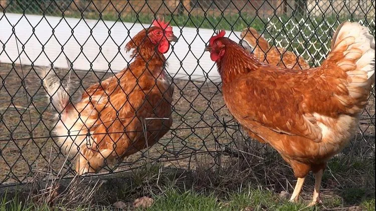
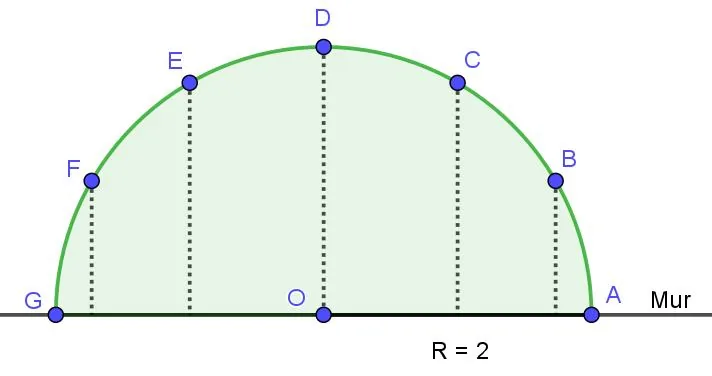

Un agriculteur souhaite construire un poulailler en forme de demi-cercle, de 2 mètres de rayon, accolé au mur de sa propriété. Le schéma ci-dessous présente une vue en plan de ce poulailler. Le grillage, représenté par l’arc de cercle vert, délimite la partie arrondie de l’enclos. Il est fixé au mur aux points $A$ et $G$, et maintenu par 5 poteaux placés régulièrement le long de l’arc, comme indiqué sur le schéma.

::: problematique
À quelle distance du mur doit-il placer chaque poteau ?
:::

:::: competence S'approprier

1. En combien de secteurs angulaires les poteaux divisent-ils l'enclos ?

::::

:::: competence Réaliser

2. Calculer l'angle en degrés qui sépare deux poteaux consécutifs.

3. Convertir cet angle en radians.

4. Calculer la longueur totale de grillage nécessaire à la construction du poulailler.

::::

:::: competence Analyser-raisonner

5. Proposer une méthode pour trouver la distance entre le mur et le poteau $B$.

   ::: remarque Appel
   Appeler le professeur et expliquer la démarche.
   :::

::::

:::: competence Réaliser

6. Calculer la distance entre le mur et le poteau $B$.

7. Calculer la distance entre le mur et le poteau $C$.

::::

:::: competence S'approprier

8. Nommer le type d'angles formés par les poteaux $B$ et $F$ ou $C$ et $E$.

::::

:::: competence Valider

9. En déduire les distances entre le mur et les poteaux $E$ et $F$.

::::

:::: competence Valider · Communiquer

10. Répondre à la problématique par une phrase.

::::
