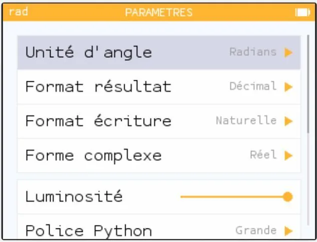
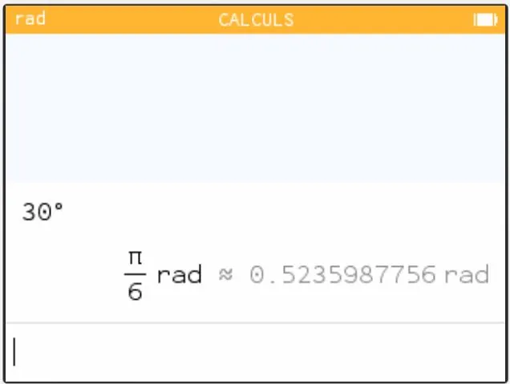

**Question 2 :** la circonférence $C$ d'un cercle de rayon $R$ est donnée par la relation $C=2\pi R$.

**Question 5 :**

- Ouvrir NumWorks.
- Dans le menu **Paramètres**, régler l'unité d'angle en radians (rad).

- Dans le menu **Calculs**, taper **30°** puis **EXE**.

**Remarque :** cette technique n'est disponible que sur l'émulateur. Sur la calculatrice, il est impossible de taper le symbole °.
