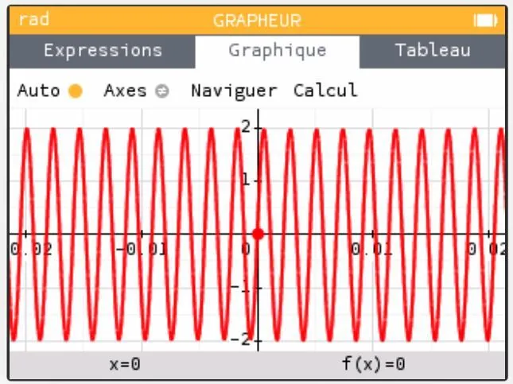
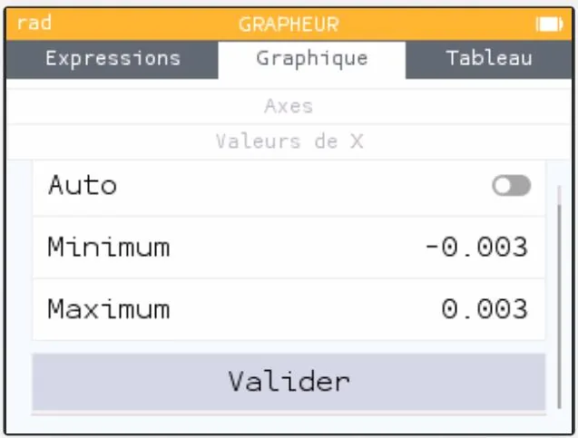
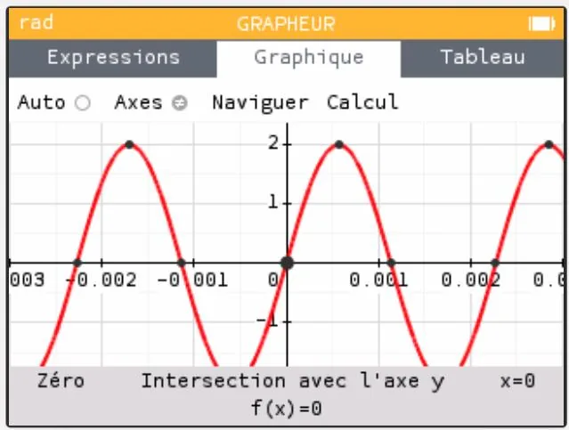

**Représenter graphiquement une fonction**

- Sélectionner le menu **« Grapheur »**.
- Saisir l'expression de la fonction.
- Sélectionner **« Tracer le graphique »**.

**Choisir l'intervalle d'affichage**

Pour représenter la fonction sur l'intervalle $[-0{,}003\,;0{,}003]$

- Sélectionner **« Axes »** puis **« Valeurs de X »**.

- Saisir les valeurs du minimum et du maximum puis **« Valider »**.

