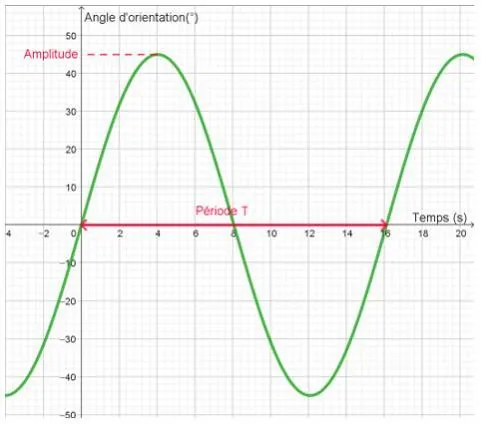

Le curseur $a$ modifie l'amplitude de la fonction sinusoïdale. Ajuster le curseur sur la valeur maximale de l'angle d'orientation du ventilateur.

Le curseur $b$ modifie la fréquence des oscillations et donc la période $T$ (qui correspond au temps pour effectuer une oscillation complète). Ajuster le curseur jusqu'à ce que la période $T$ corresponde au temps d'un aller-retour du ventilateur.

