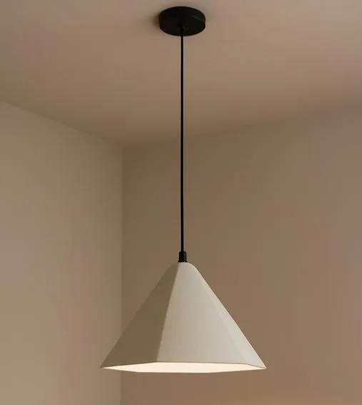
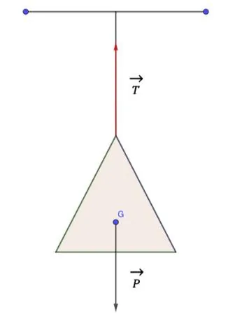

Mahé est bricoleur. Il vient de monter lui-même une suspension lumineuse pour sa chambre. Cette suspension est fixée au plafond par un fil vertical. Elle a une masse de 700 grammes. Une fois le montage terminé, Mahé s'interroge : « Est-ce que le fil supportera le poids de la lampe, ou risque-t-elle de tomber ? »

::: problematique
Comment expliquer que la suspension reste accrochée sans tomber ?
:::

1. Quel est l'objet qui est étudié dans ce problème ?

2. On a modélisé le problème de la suspension de la façon suivante.

   

   D'après ce schéma, deux forces sont exercées sur la suspension : la tension du fil $\vec{T}$ et le poids $\vec{P}$. Le poids $\vec{P}$ est la force exercée par la Terre sur l'objet ($P = \text{masse} \times \text{intensité de la pesanteur}$).

   Ces deux forces sont modélisées par un opérateur mathématique appelé **vecteur**. Un vecteur est représenté graphiquement par un segment fléché. On le note par une lettre surmontée d'une flèche.

   1. Convertir la masse de la suspension en kg.

   2. Sachant que l'intensité de la pesanteur $g = 9{,}8 \,\text{N/kg}$, calculer le poids de la suspension.

      Un vecteur se caractérise par sa direction, son sens, sa norme (ou longueur). Sur le schéma, les vecteurs $\vec{T}$ et $\vec{P}$ mesurent chacun 3 cm.

3. On s'intéresse au vecteur $\vec{P}$. Choisir la bonne réponse parmi les propositions suivantes.

   1. La direction de la force $\vec{P}$ est :

      - horizontale
      - verticale
      - oblique

   2. Le sens de la force $\vec{P}$ est :

      - vers le haut
      - vers le bas
      - vers la droite

   3. Sa norme est :

      - 3 cm
      - 3 m
      - 30 cm

4. On s'intéresse au vecteur $\vec{T}$. Choisir la bonne réponse parmi les propositions suivantes.

   1. La direction de la force $\vec{T}$ est :

      - horizontale
      - verticale
      - oblique

   2. Le sens de la force $\vec{T}$ est :

      - vers le haut
      - vers le bas
      - vers la droite

   3. Sa norme est :

      - 3 cm
      - 3 m
      - 30 cm

5. Les vecteurs $\vec{P}$ et $\vec{T}$ sont-ils opposés ? égaux ? colinéaires ? (plusieurs réponses sont possibles)

   ::: coup-de-pouce x-suspension
   :::

6. Voici l'énoncé d'une loi de physique : « *Quand un solide est soumis à deux forces, il est en équilibre si et seulement si les deux forces ont la même direction, sont de sens opposés et ont la même norme (ou intensité).* »

   D'après les résultats des questions précédentes et la loi énoncée, la suspension est-elle en équilibre ?

7. Répondre à la problématique.
