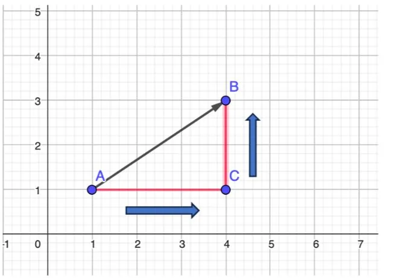

**Déterminer graphiquement les coordonnées d'un vecteur dans le plan rapporté à un repère orthogonal**

On considère un vecteur $\overrightarrow{AB}$ dans le plan rapporté à un repère orthogonal. Le vecteur $\overrightarrow{AB}$ a pour origine le point $A$ et pour extrémité le point $B$.

Pour déterminer les coordonnées du vecteur $\overrightarrow{AB}$ :

- Tracer le triangle rectangle $ABC$ en plaçant le point $C$ au niveau de l'angle droit.
- Positionner son crayon sur l'origine du vecteur (ici le point $A$).
- Déplacer son crayon horizontalement jusqu'au point $C$ et noter le nombre de carreaux de déplacement (ici 3 carreaux) vers la droite (signe positif). On obtient l'abscisse qui est « +3 ».
- Déplacer son crayon verticalement jusqu'au point $B$ et noter le nombre de carreaux de déplacement (ici 2 carreaux) vers le haut (signe positif). On obtient l'ordonnée qui est « +2 ».
- Les coordonnées du vecteur sont $\overrightarrow{AB}(3;2)$.

Attention

- Pour des déplacements horizontaux vers la gauche, le signe est négatif.
- Pour des déplacements verticaux vers le bas, le signe est négatif.

**Calculer les coordonnées d'un vecteur connaissant les coordonnées des points d'origine et d'extrémité**

Dans le plan rapporté à un repère orthogonal, on considère deux points $A$ et $B$ de coordonnées $A (x_A;y_A)$ et $B(x_B;y_B)$.

**Formule :** les coordonnées du vecteur $\overrightarrow{AB}$ sont données en appliquant la relation : $\overrightarrow{AB}(x_B-x_A;y_B-y_A)$.

**Exemple**

On considère un point $A(4;6)$ et un point $B(1;5)$.

Le vecteur $\overrightarrow{AB}$ a pour coordonnées :

$\overrightarrow{AB}(x_B-x_A;y_B-y_A)$

$\overrightarrow{AB}(1-4;5-6)$

$\overrightarrow{AB}(-3;-1)$

### Reconnaître des vecteurs égaux ou colinéaires à partir de leurs coordonnées

On considère deux vecteurs $\overrightarrow{AB} (x ; y)$ et $\overrightarrow{CD} (x' ; y')$.

Définitions

- Deux vecteurs sont égaux si et seulement si leurs coordonnées sont identiques, autrement dit si $x = x'$ et $y = y'$.
- Deux vecteurs sont colinéaires si et seulement s'il existe un réel $k$ tel que $\overrightarrow{CD} = k \times\overrightarrow{AB}$.

**Exemple**

On considère les vecteurs $\overrightarrow{AB}(2;3)$ et $\overrightarrow{CD}(4;6)$.

On constate que $\overrightarrow{CD} = 2\times \overrightarrow{AB}$.

Les vecteurs $\overrightarrow{CD}$ et $\overrightarrow{AB}$ sont donc colinéaires.

Ils ont la même direction et le même sens car $k>0$.
