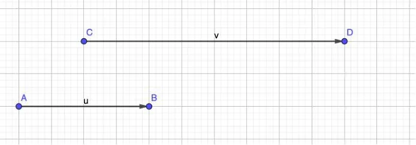
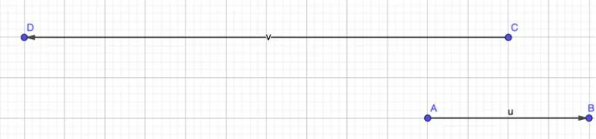

On considère un vecteur $\vec{u}$ et un réel $k$.

**Définition :** le produit du vecteur $\vec{u}$ par un réel $k$ noté $k\vec{u}$ est le vecteur $\vec{v}$ dont les caractéristiques sont les suivantes.

- Les vecteurs $\vec{u}$ et $\vec{v}$ ont la même direction (ils sont donc colinéaires).
- Si $k > 0$, alors $\vec{u}$ et $\vec{v}$ ont le même sens et, si $k < 0$, alors $\vec{u}$ et $\vec{v}$ sont de sens opposés.
- Si $k > 0$, $\left\|k\vec{u}\right\|= k \times \left\|\vec{u}\right\|$ ; si $k < 0$, $\left\|k\vec{u}\right\|= -k \times \left\|\vec{u}\right\|$.

**Exemples**

- Construire le vecteur $\vec{v}$ à partir du point $C$ tel que $\vec{v}=2\times\vec{u}$.

- Construire le vecteur $\vec{v}$ à partir du point $C$ tel que $\vec{v}=-3\times\vec{u}$.

