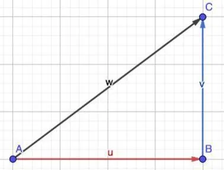

On considère deux vecteurs du plan $\vec{u}$ et $\vec{v}$.

**Définition :** la somme de deux vecteurs $\vec{u}+\vec{v}$ est un nouveau vecteur $\vec{w}$ que l'on obtient en plaçant le point de départ du vecteur $\vec{v}$ à l’extrémité du vecteur $\vec{u}$.
$\vec{w} = \vec{u} + \vec{v}$

### Relation de Chasles

On considère 3 points $A$, $B$ et $C$ du plan.

La relation de Chasles permet d'écrire que : $\overrightarrow{AB}+\overrightarrow{BC}=\overrightarrow{AC}$.

### Règle du parallélogramme

On considère 4 points $A$, $B$, $C$ et $D$ du plan.

Les vecteurs $\overrightarrow{AB}$ et $\overrightarrow{AC}$ ont la même origine.

La somme des vecteurs $\overrightarrow{AB}$ et $\overrightarrow{AC}$ est le vecteur $\overrightarrow{AD}$ qui est la diagonale du parallélogramme $ABCD$.

$\overrightarrow{AB}+\overrightarrow{AC}=\overrightarrow{AD}$

