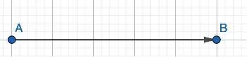
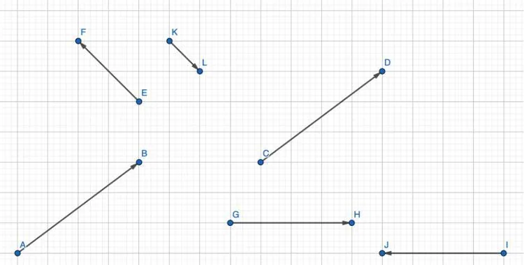

**Définition :** un vecteur est un opérateur mathématique représenté graphiquement par un segment fléché.

Notation : un vecteur s'écrit le plus souvent à l'aide de deux lettres majuscules surmontées d'une flèche, mais on trouve parfois une notation à l'aide d'une seule lettre minuscule (exemple : le vecteur $\vec{u}$).

**Exemple**

Le vecteur $\overrightarrow{AB}$.

Le point $A$ est l'origine du vecteur $\overrightarrow{AB}$ et le point $B$ est son extrémité.

Un vecteur possède plusieurs caractéristiques :

- une direction ;
- un sens ;
- une norme (ou longueur).

**Exemple**

Le vecteur $\overrightarrow{AB}$ a :

- une direction horizontale ;
- un sens allant du point $A$ vers le point $B$ ;
- une norme notée $\left\|\overrightarrow{AB}\right\|= 5 \,\text{cm}$.

Propriétés

- Deux vecteurs sont égaux si et seulement s'ils ont la même direction, le même sens et la même norme.
- Deux vecteurs sont opposés si et seulement s'ils ont la même direction, la même norme mais de sens opposés.
- Deux vecteurs sont colinéaires si et seulement s'ils ont la même direction mais pas forcément le même sens et la même norme.
- Le vecteur nul se note $\vec{0}$ et sa caractéristique est que sa longueur est nulle.

**Exemples**

- Les vecteurs $\overrightarrow{AB}$ et $\overrightarrow{CD}$ sont égaux car ils ont même direction, même sens et même norme.
- Les vecteurs $\overrightarrow{GH}$ et $\overrightarrow{IJ}$ sont opposés car ils ont même direction, même norme mais sont de sens opposés.
- Les vecteurs $\overrightarrow{EF}$ et $\overrightarrow{KL}$ sont colinéaires car ils ont la même direction mais pas forcément la même norme et le même sens.
- Si deux points $M$ et $N$ sont confondus alors on dit que le vecteur $\overrightarrow{MN}=\vec{0}$ (vecteur nul).
