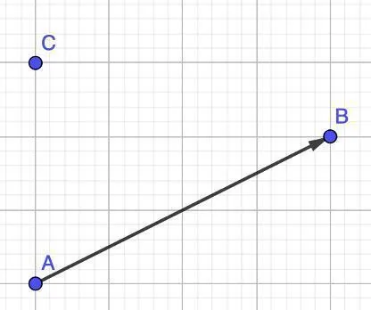
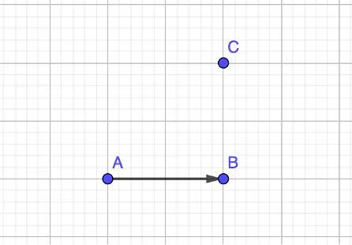
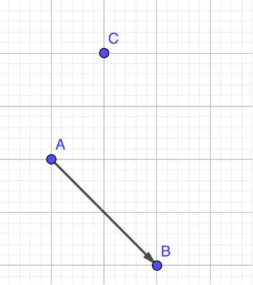
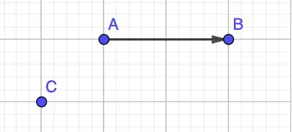

Dans chacun des cas suivants, représenter le vecteur $\overrightarrow{CD}$ tel que :

1. $\overrightarrow{AB} = 2\overrightarrow{CD}$

   

2. $\overrightarrow{AB} = -3\overrightarrow{CD}$

   

3. $\overrightarrow{AB} = -\frac12\overrightarrow{CD}$

   

4. $\overrightarrow{AB} = -\frac32 \overrightarrow{CD}$

   
