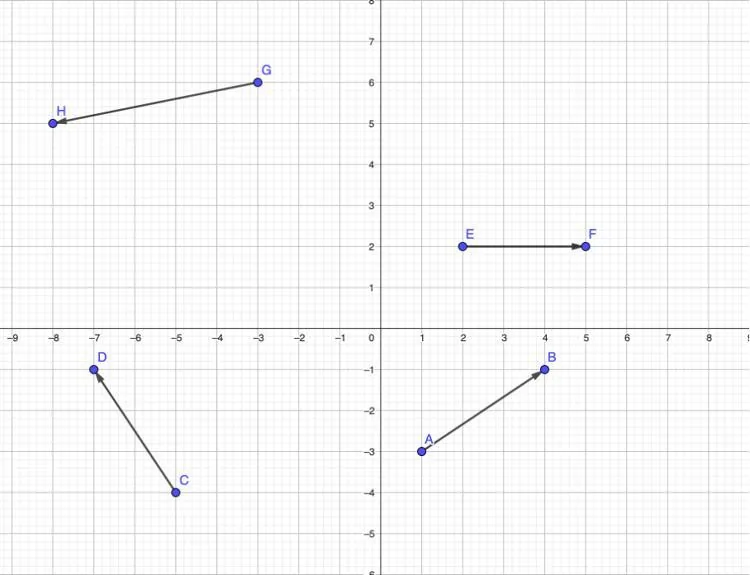

Les vecteurs suivants sont représentés dans le plan dans un repère orthogonal.

1. Donner les coordonnées des vecteurs $\overrightarrow{AB}$, $\overrightarrow{CD}$, $\overrightarrow{EF}$ et $\overrightarrow{GH}$.

2. Calculer la norme des vecteurs $\overrightarrow{AB}$, $\overrightarrow{CD}$, $\overrightarrow{EF}$ et $\overrightarrow{GH}$.

3. Calculer les coordonnées de $\overrightarrow{AB} + \overrightarrow{CD}$ puis la norme $\left\|\overrightarrow{AB}+\overrightarrow{CD}\right\|$.

4. Calculer les coordonnées de $\overrightarrow{EF} + \overrightarrow{GH}$ puis la norme $\left\|\overrightarrow{EF}+\overrightarrow{GH}\right\|$.
