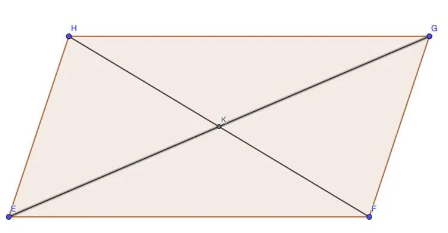

$EFGH$ est un parallélogramme dont les diagonales $GE$ et $FH$ se coupent en un point $K$.

Compléter les égalités suivantes :

1. $\overrightarrow{EH} + \overrightarrow{EF} = \ldots$

2. $\overrightarrow{FG} + \overrightarrow{FE} = \ldots$

3. $\overrightarrow{GK} + \overrightarrow{KF} = \ldots$

4. $\overrightarrow{HK} + \overrightarrow{FK} = \ldots$

5. $\overrightarrow{GH} + \overrightarrow{HK} = \ldots$

6. $2\overrightarrow{EK} + \overrightarrow{GF} = \ldots$

7. $-\overrightarrow{HE} + \overrightarrow{HG} = \ldots$
