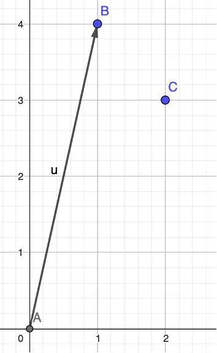
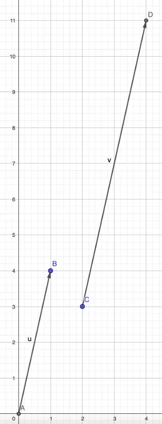

On considère le vecteur $\vec{u}(1;4)$ et le point $C(2;3)$ dans le plan.

À l'aide de GeoGebra, on souhaite :

- placer le vecteur $\vec{u}$ et le point $C$ dans le plan ;
- construire le vecteur $\vec{v}= 2 \times \vec{u}$.

1. Ouvrir GeoGebra.

2. En partant de l'origine du repère et en utilisant l'outil **« Vecteur »**, tracer le vecteur $\vec{u}$ et placer le point $C$.

   

3. Il faut tracer le point $D$ tel que $\vec{v}= 2 \times \vec{u}$.

   Saisir dans la fenêtre Algèbre la commande **« D = C + 2u »**.

4. Le point $D$ apparaît sur le plan. Pour tracer le vecteur $\vec{v}$, utiliser l'outil **« Vecteur »**. Cliquer sur l'origine qui correspond au point $C$ puis sur l'extrémité qui correspond au point $D$.

   
