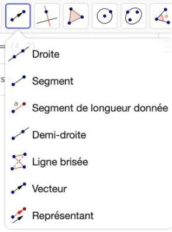
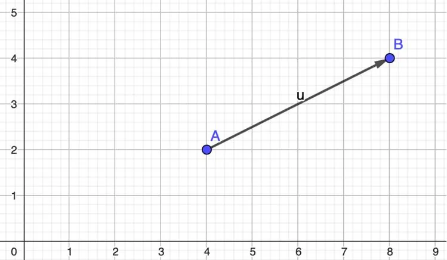
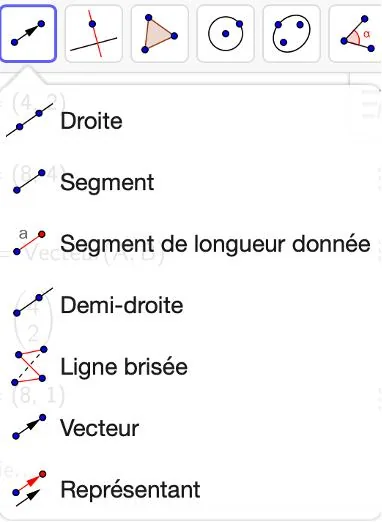
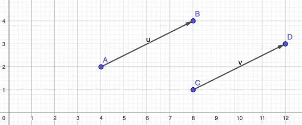

On considère un vecteur $\overrightarrow{AB}$ et un point $C$ du plan. On souhaite construire un représentant du vecteur $\overrightarrow{AB}$ à partir du point $C$.

**Remarque :** construire le représentant d’un vecteur à partir d’un point signifie tracer un vecteur ayant la même direction, le même sens et la même norme que le vecteur donné, mais dont l’origine est un nouveau point.

1. Ouvrir GeoGebra.

2. Tracer un point $A$ sur le graphique.

3. Cliquer sur l'outil **« Vecteur »**.

   

4. Tracer le vecteur $\overrightarrow{AB}$.

   

5. Tracer un point $C$ sur le graphique.

6. Cliquer sur l'outil **« Représentant »**.

   

7. Sur le graphique, cliquer sur le point $C$ puis sur le vecteur $\overrightarrow{AB}$.

8. Un représentant du vecteur $\overrightarrow{AB}$ apparaît sur le graphique sous le nom du vecteur $\overrightarrow{CD}$. Il a les mêmes caractéristiques que le vecteur $\overrightarrow{AB}$ (direction, sens et norme).

   
