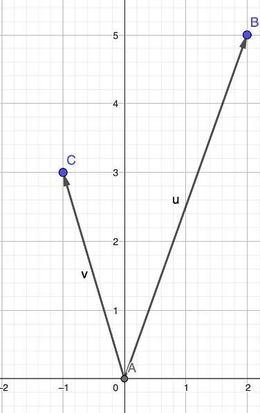
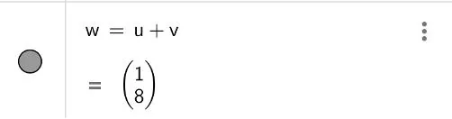
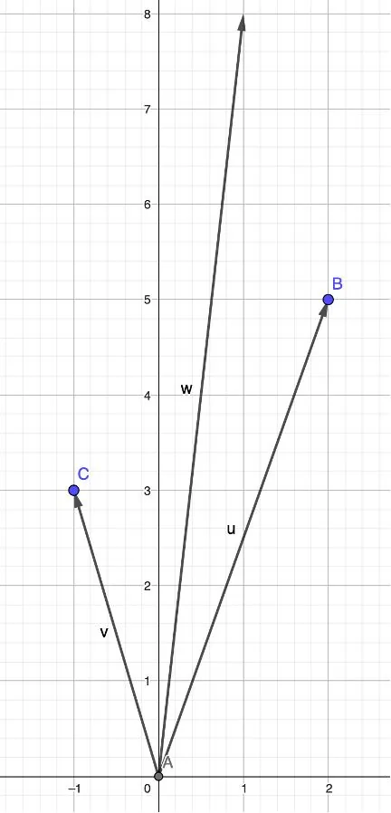

On considère deux vecteurs $\vec{u}$ et $\vec{v}$ dans le plan.

À l'aide de GeoGebra, on souhaite :

- placer les vecteurs $\vec{u} (2;5)$ et $\vec{v} (-1;3)$ dans le plan ;
- construire la somme des deux vecteurs $\vec{u}$ et $\vec{v}$.

1. Ouvrir GeoGebra.

2. En partant de l'origine du repère et en utilisant l'outil **« Vecteur »**, tracer les vecteurs $\vec{u}$ et $\vec{v}$.

   

3. Dans la fenêtre **« Algèbre »**, saisir et créer le vecteur **« w = u + v »**.

   

4. Le vecteur $\vec{w}$ apparaît sur le graphique, résultat de la somme de $\vec{u}+\vec{v}$.

   
