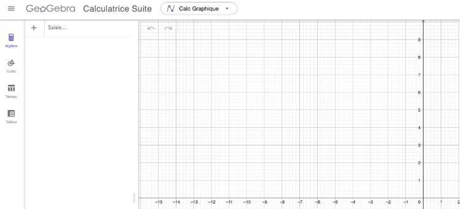
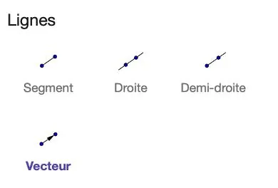
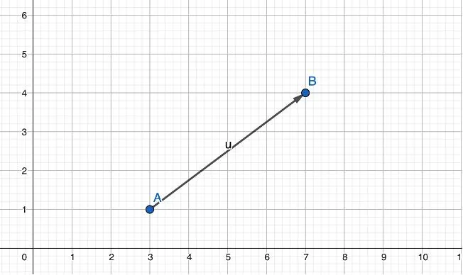

1. Ouvrir [GeoGebra Calculatrice Suite](https://www.geogebra.org/calculator?lang=fr).

   

2. Cliquer sur l'onglet **« Outils »**.

3. Dans la rubrique **« Lignes »**, cliquer sur l'outil **« Vecteur »**.

   

4. Cliquer une première fois sur le graphique pour placer l’origine du vecteur, puis cliquer une seconde fois à l’endroit souhaité pour définir son extrémité.

   
