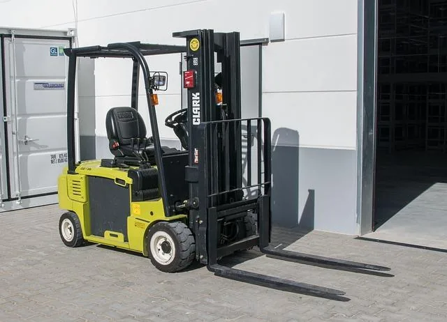

Mohand est employé dans une entreprise de logistique. Il travaille actuellement sur un chantier où les matériaux sont livrés et déplacés à l’aide d’un chariot élévateur. Son rôle est d’organiser les trajets de livraison de manière efficace pour réduire les distances parcourues, gagner du temps et économiser le carburant et l’énergie du conducteur.

::: problematique
Quelle est la meilleure stratégie de déplacement pour que le chariot élévateur effectue sa livraison le plus efficacement possible, en matière de distance à parcourir ?
:::

Le chantier est représenté dans un repère orthogonal :

- $A (1 ; 2)$ : point de départ du chariot élévateur et zone de chargement des matériaux ;
- $B(5 ; 6)$ : zone de contrôle obligatoire imposée par l'entreprise ;
- $C (10 ; 9)$ : zone de déchargement où les matériaux doivent être livrés.

1. Calculer les coordonnées des vecteurs $\overrightarrow{AB}$ et $\overrightarrow{AC}$.

2. Que représentent ces deux vecteurs dans le contexte du chantier ?

3. Calculer les coordonnées du vecteur $\overrightarrow{BC}$.

4. En déduire, à l'aide de leurs coordonnées, la somme des deux vecteurs pour se rendre du point $A$ vers le point $B$ puis du point $B$ vers le point $C$. Préciser la règle appliquée.

5. Comparer le résultat de la question **4** avec les coordonnées du vecteur $\overrightarrow{AC}$.

6. La relation de Chasles est-elle vérifiée ?

7. Calculer les normes $\left\|\overrightarrow{AB}\right\|$, $\left\|\overrightarrow{BC}\right\|$ et $\left\|\overrightarrow{AC}\right\|$.

8. Quelle proposition Mohand pourrait-il faire à son entreprise pour optimiser son chemin sachant qu'il doit passer par la zone de contrôle pour faire vérifier sa marchandise ?

9. Répondre à la problématique.
