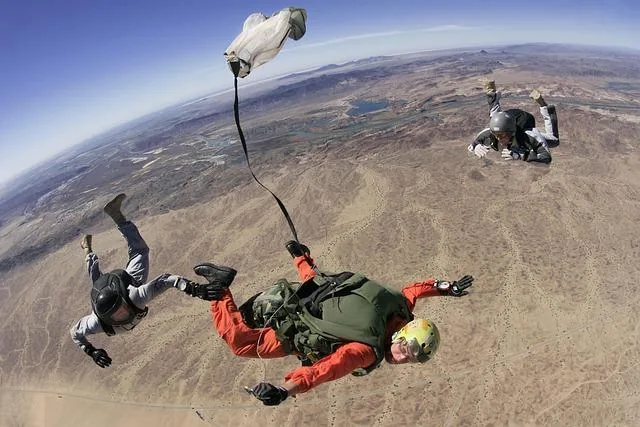
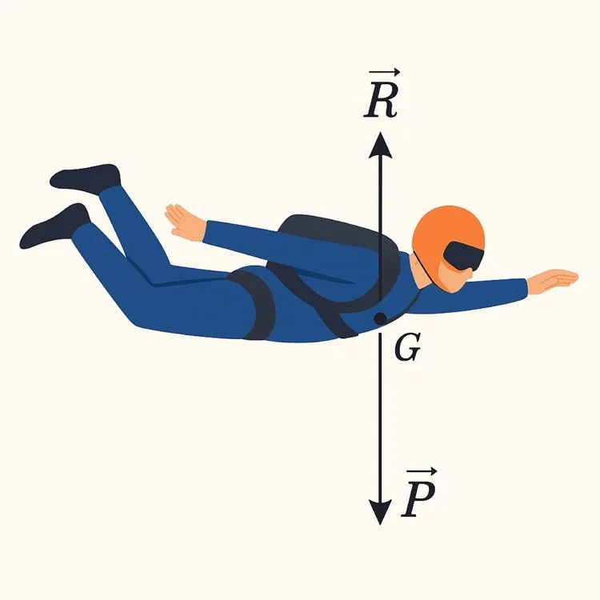

Un parachutiste saute d’un avion à haute altitude. Lors de sa chute, il subit deux forces principales :

- son poids, qui le tire vers le bas ;
- la résistance de l’air, dirigée vers le haut, qui freine sa chute.

**Données :**

- Masse du parachutiste : 70 kg.
- Intensité de la pesanteur : $g = 10 \,\text{N/kg}$.
- Coordonnées : $\vec{P} (0;-700)$.
- Coordonnées : $\vec{R}(0;700)$.

::: problematique
Que se passerait-il s’il n’y avait aucune résistance de l’air ?
:::

Le schéma ci-dessous permet de modéliser la situation en représentant les deux forces principales agissant sur le parachutiste à l’aide de vecteurs, tous deux appliqués au point $G$, considéré comme le centre de gravité du parachutiste.

1. Calculer la valeur du poids $P$ sachant que $P = \text{masse} \times \text{intensité de la pesanteur}$.

2. Calculer la norme $\left\|\vec{R}\right\|$.

3. Quelles sont les caractéristiques (direction, sens et intensité en N) :

   - du poids $\vec{P}$ ?

   - de la résistance de l'air $\vec{R}$ ?

4. Le parachutiste est en situation d’équilibre si et seulement si la somme des forces qui s’exercent sur lui est nulle. Dans ce cas, il continue de chuter, mais à une vitesse constante.

   Calculer la somme $\vec{F}=\vec{P} + \vec{R}$ et vérifier si la condition d'équilibre est respectée.

5. On modifie les conditions et on considère qu'il n'y a pas de résistance de l'air, c'est-à-dire que $\vec{R}(0;0)$.

   1. Calculer la nouvelle résultante $\vec{F}=\vec{P} + \vec{R}$.

   2. Calculer la norme $\left\|\vec{F}\right\|$.

   3. Peut-on dire que le parachutiste continue à chuter à vitesse constante si on néglige la résistance de l’air ? Préciser la valeur de la force à laquelle il est soumis et l'allure de sa vitesse.

6. Que peut-on conclure sur la sécurité du parachutiste si l’on néglige la résistance de l’air ? Serait-il en sécurité ou en danger ? Justifier la réponse.

7. Répondre à la problématique.
