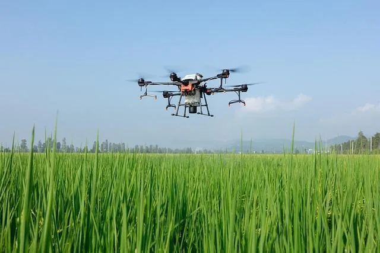

Un centre hospitalier d’urgence utilise un drone médical pour livrer rapidement des poches de sang entre deux sites. La trajectoire du drone est suivie en temps réel sur un écran par le personnel médical. Ce dernier s’appuie sur un graphique pour visualiser sa position et sa direction. Le drone vole avec une vitesse donnée par un vecteur $\overrightarrow{VR}$ en km/h, mais un vent souffle et modifie sa trajectoire.

**Données :**

- Point de départ : $A(0;0)$.
- Point d'arrivée : $B(6;8)$.
- Vecteur vitesse du drone : $\overrightarrow{VR}$.
- Vecteur vitesse du vent : $\overrightarrow{AC}(1;2)$.
- 1 unité correspond à 1 km/h.

::: problematique
Comment programmer correctement la vitesse du drone pour qu’il atteigne le point $B$, en tenant compte du vent ?
:::

::: coup-de-pouce x-drone
:::

:::: competence S'approprier

1. Quelle est la conséquence de l'arrivée du vent sur le drone ?

::::

:::: competence Réaliser

2. Calculer les coordonnées du vecteur $\overrightarrow{AB}$.

3. À l'aide de GeoGebra, tracer les vecteurs :

   - $\overrightarrow{AB}$
   - $\overrightarrow{AC}$
   - $\overrightarrow{AB} + \overrightarrow{AC}$

   ::: remarque Appel
   Appeler l'enseignant pour vérifier les constructions.
   :::

::::

:::: competence Analyser-raisonner

4. À quoi correspond le vecteur somme $\overrightarrow{AB} + \overrightarrow{AC}$ par rapport au problème qui est posé ?

::::

:::: competence Valider

5. En déduire où arrivera le drone s'il suit cette trajectoire.

::::

:::: competence S'approprier · Réaliser

6. Calculer la norme $\left\|\overrightarrow{AB}+\overrightarrow{AC}\right\|$. Arrondir à l'unité.

::::

:::: competence Analyser-raisonner

7. À quoi correspond cette valeur ?

::::

8. On souhaite corriger la trajectoire du drone et lui programmer la bonne vitesse (modélisée par le vecteur $\overrightarrow{VR}$) pour qu’il atteigne exactement le point $B$ malgré le vent.

:::: competence S'approprier

**8.a** Donner la formule vectorielle de la vitesse réelle du drone en fonction des vecteurs $\overrightarrow{AB}$, $\overrightarrow{AC}$ et $\overrightarrow{VR}$ lorsqu’on tient compte du vent.

::::

:::: competence Réaliser

**8.b** En utilisant cette formule, écrire puis résoudre une équation vectorielle permettant de calculer la vitesse à programmer pour que le drone suive correctement la trajectoire de $A$ vers $B$.

::::

:::: competence Analyser-raisonner

**8.c** Analyser la nouvelle position du drone si on utilise cette vitesse corrigée.

::: remarque Appel
Appeler l’enseignant pour lui expliquer sur le graphique la trajectoire corrigée.
:::

::::

:::: competence Réaliser · Valider

9. Calculer la norme $\left\|\overrightarrow{VR}\right\|$ puis en déduire à quoi correspond cette valeur (arrondir à l'unité).

::::

:::: competence Communiquer

10. Conclure en répondant à la problématique.

::::
