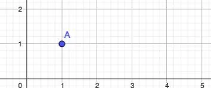
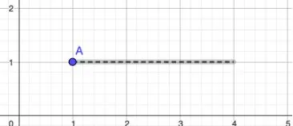
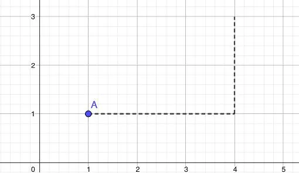
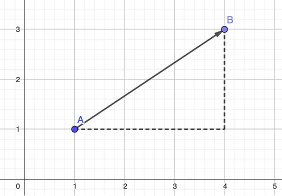

Traçons le vecteur $\overrightarrow{AB}(3;2)$.

**Étape 1.** On trace le point de départ. On prend l’origine du vecteur qui est, dans notre cas, le point $A$.

**Étape 2.** On se déplace de 3 unités vers la droite puisque l'abscisse est positive.

**Étape 3.** On se déplace de 2 unités vers le haut puisque l'ordonnée est positive.

**Étape 4.** On trace le vecteur entre le point de départ et le point d’arrivée.

