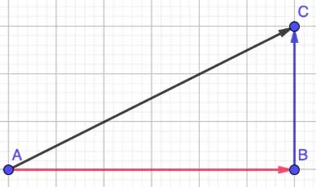
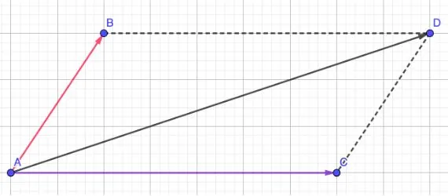

Il existe deux règles pour additionner deux vecteurs.

1. **Relation de Chasles**

   On considère 3 points $A$, $B$ et $C$ du plan.

   La relation de Chasles permet d'écrire que : $\overrightarrow{AB}+\overrightarrow{BC}=\overrightarrow{AC}$.

   

2. **Règle du parallélogramme**

   On considère 4 points $A$, $B$, $C$ et $D$ du plan.

   Les vecteurs $\overrightarrow{AB}$ et $\overrightarrow{AC}$ ont la même origine.

   La somme des vecteurs $\overrightarrow{AB}$ et $\overrightarrow{AC}$ est le vecteur $\overrightarrow{AD}$ qui est la diagonale du parallélogramme $ABCD$.

   $\overrightarrow{AB}+\overrightarrow{AC}=\overrightarrow{AD}$

   
