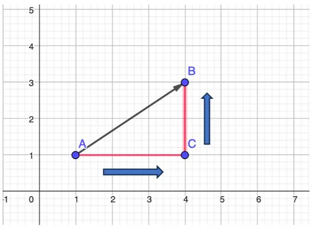

Déterminons les coordonnées du vecteur $\overrightarrow{AB}$ :

- Tracer le triangle rectangle $ABC$ en plaçant le point $C$ au niveau de l'angle droit.
- Positionner son crayon sur l'origine du vecteur (ici le point $A$).
- Déplacer son crayon horizontalement jusqu'au point $C$ et noter le nombre de carreaux de déplacement (ici 3 carreaux) vers la droite (signe positif). On obtient l'abscisse qui est « +3 ».
- Déplacer son crayon verticalement jusqu'au point $B$ et noter le nombre de carreaux de déplacement (ici 2 carreaux) vers le haut (signe positif). On obtient l'ordonnée qui est « +2 ».
- Les coordonnées du vecteur sont $\overrightarrow{AB}(3;2)$.

Attention

- Pour des déplacements horizontaux vers la gauche, le signe est négatif.
- Pour des déplacements verticaux vers le bas, le signe est négatif.
