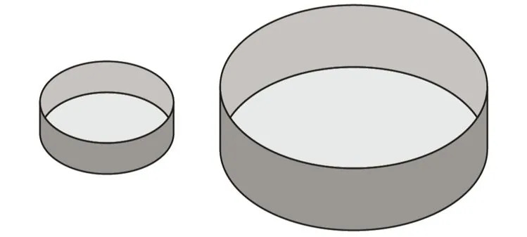

Une pâtissière commande deux moules à panettone dont les dimensions sont :

- moule 1 : $d_1 = 10 \text{ cm}$ et $h_1 = 8 \text{ cm}$ ;
- moule 2 : $d_2 = 20 \text{ cm}$ et $h_2 = 16 \text{ cm}$.

::: problematique
Le panettone préparé avec le moule 2 permettra-t-il de servir deux fois plus de personnes que celui du moule 1 ?
:::

1. Le moule 2 est-il un agrandissement du moule 1 ? Si oui, de quel coefficient $k$ ?

2. Calculer le volume de pâte nécessaire pour faire un panettone dans chacun des deux moules. On suppose que chaque moule est complètement rempli.

   ::: coup-de-pouce m-volume-cylindre
   :::

3. Le deuxième moule contient-il un volume de pâte deux fois plus grand que le premier ? Sinon, combien de fois plus ?

4. On imagine un troisième moule qui soit un agrandissement de coefficient 3 du moule 1. De quel volume de pâte aura-t-on alors besoin pour préparer un gâteau dans ce moule ?
