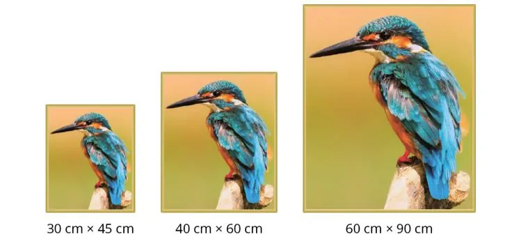
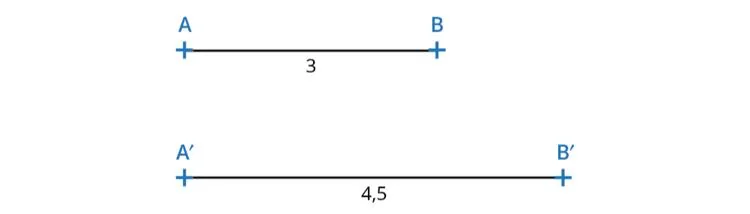

Andrea souhaite décorer sa maison. Pour cela, elle veut commander des cadres contenant ses photos et tombe sur les propositions de tailles suivantes.

### Partie A — Appropriation du problème

Pour calculer un coefficient d'agrandissement $k$, il faut trouver par quel nombre les longueurs d'une figure ont été multipliées.

Pour passer de AB à A'B', on sait que les longueurs ont été multipliées par $k$. Calculer $k$.

::: coup-de-pouce x-photos
:::

### Partie B — Application aux cadres

1. Par quel nombre ont été multipliées les dimensions pour passer du petit cadre au moyen ?

2. Par quel nombre ont été multipliées les dimensions pour passer du petit cadre au grand ?

3. Andrea souhaite avoir une image dont les dimensions sont quatre fois plus grandes que celles du petit cadre. Quelles seront les dimensions du nouveau cadre ?
