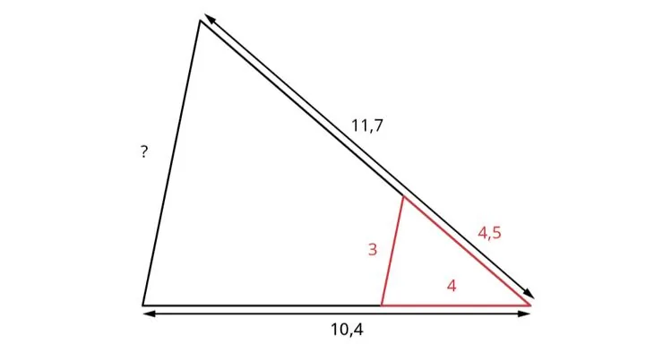
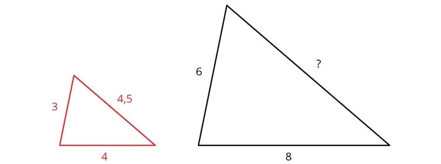
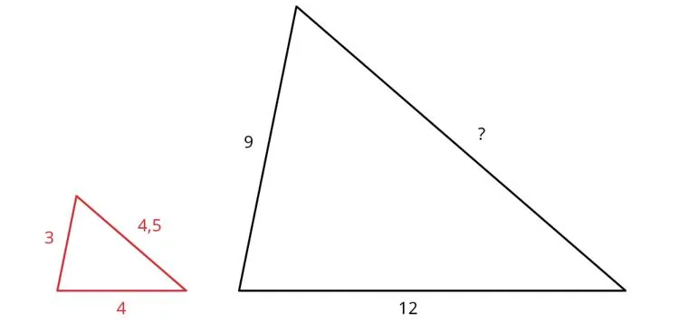

Le théorème de Thalès permet de calculer une longueur manquante dans le cas de deux triangles semblables, comme sur le schéma ci-dessous.

Dans cette activité, on suit un raisonnement qui permet de comprendre la méthode.

### Partie A — Cas d'un agrandissement simple

On agrandit un triangle dont on connaît les dimensions.

1. Quel coefficient d'agrandissement permet de passer du petit au grand triangle ?

2. Calculer la longueur manquante.

3. On réalise un autre agrandissement de ce même triangle.

   

   Calculer à nouveau la longueur manquante.

### Partie B — Cas d'un agrandissement regroupé

On a regroupé le triangle précédent avec son agrandissement.

1. Quel coefficient d'agrandissement permet de passer du triangle rouge au triangle noir ?

2. En appliquant ce coefficient au segment de longueur 3, retrouve-t-on les dimensions du triangle précédent ?

3. On réalise un autre agrandissement du petit triangle. Calculer la longueur manquante.

   

::: coup-de-pouce x-triangles
:::
