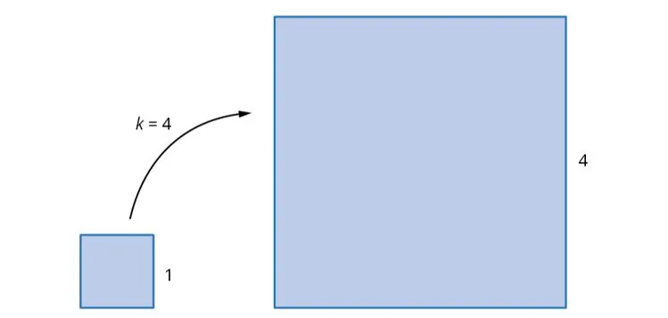
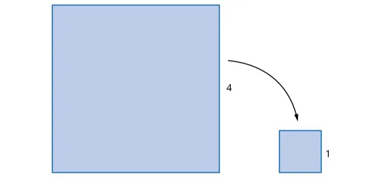

### Agrandissement

Agrandir une figure, c’est la reproduire en plus grand en multipliant toutes ses dimensions par un même coefficient $k > 1$.

**Exemple :** les dimensions de la figure ont été multipliées par 4 pour former l'agrandissement.

### Réduction

Réduire une figure, c’est la reproduire en plus petit en multipliant toutes ses dimensions par un même coefficient $k$ compris entre 0 et 1.

**Exemple :** les dimensions de la figure ont été multipliées par $\dfrac{1}{4}$ pour former la réduction.

::: remarque
Une figure agrandie ou réduite conserve la **même forme** et les **mêmes propriétés géométriques** (angles, parallélisme…) : seules les dimensions changent.
:::
