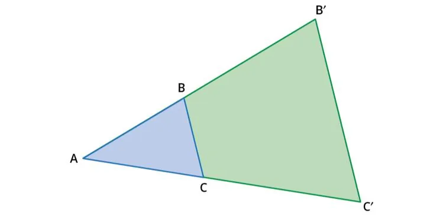
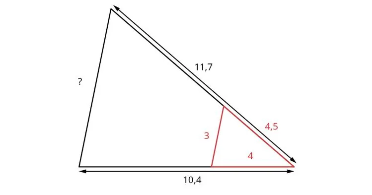

**Théorème de Thalès**

Si deux droites parallèles coupent deux droites sécantes, alors elles déterminent deux triangles dont les côtés correspondants ont des longueurs proportionnelles.

Si on appelle $k$ le coefficient d'agrandissement entre les deux triangles ci-dessous, on a :

$\text{AB} = k \times \text{A}'\text{B}'$ ; $\text{AC} = k \times \text{A}'\text{C}'$ ; $\text{BC} = k \times \text{B}'\text{C}'$.

Une autre manière d’exprimer ces égalités est d'écrire : $\dfrac{\text{AC}}{\text{A}'\text{C}'}=\dfrac{\text{AB}}{\text{A}'\text{B}'}=\dfrac{\text{BC}}{\text{B}'\text{C}'}=k$.

**Exemple**

Dans cette figure, on a l'égalité suivante : $\dfrac{10{,}4}{4} = \dfrac{11{,}7}{4{,}5} = \dfrac{?}{3} = 2{,}6=k$.

**Remarque :** pour calculer la valeur inconnue, il suffit d'écrire : $? = 3\times 2{,}6 = 7{,}8$.
