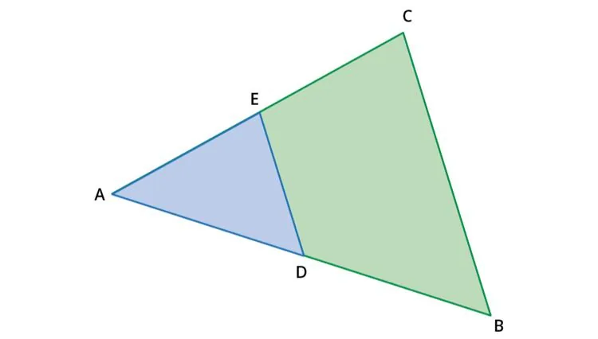
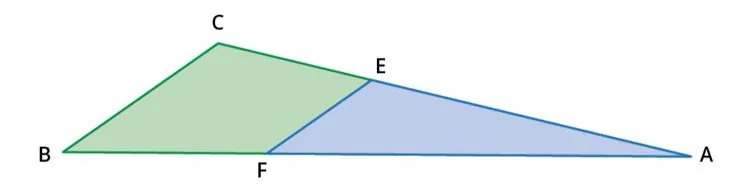
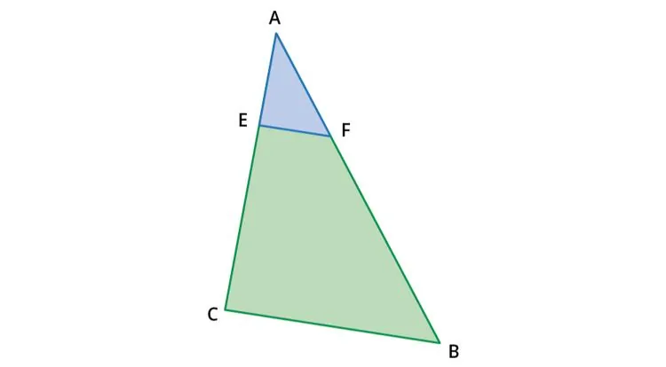
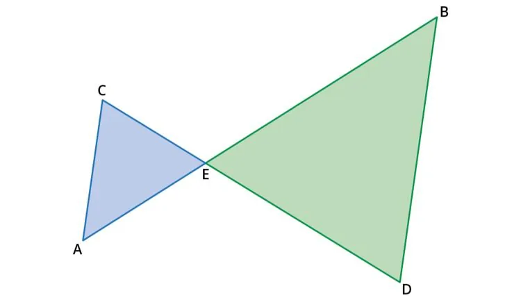

Dans chacune des quatre configurations, l'un des triangles est la réduction de l'autre. À l'aide du théorème de Thalès, calculer la longueur recherchée.

1. Dans la figure suivante, on sait que $\text{AE}=4$, $\text{AC} =8$ et $\text{DE} = 3$.
   Calculer la valeur de $\text{BC}$.

   

2. Dans la figure suivante, $\text{AC} = 10$, $\text{AE} = 7{,}5$ et $\text{BC} = 4$.
   Calculer $\text{EF}$.

   

3. Dans la figure suivante, $\text{AE} = 3{,}2$, $\text{AC} = 8{,}96$ et $\text{AB} = 9{,}8$.

   Calculer la longueur de $\text{AF}$.

   

4. Dans la figure suivante, $\text{CE} = 3{,}4$, $\text{CD} = 13{,}6$ et $\text{AE} = 4{,}3$.

   Calculer la longueur de $\text{BE}$.

   
