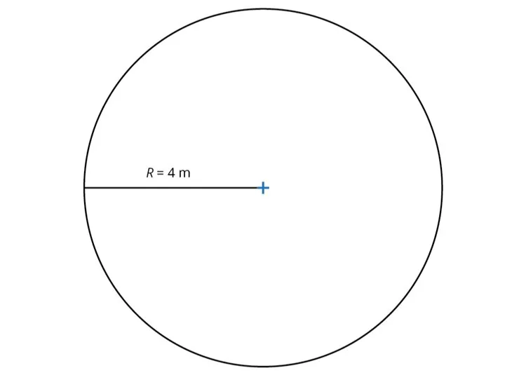

**Principe**

Pour calculer l'aire d'un disque dont le rayon $R$ est connu, on applique la formule : $A_\text{disque} = \pi \times R^2$.

**Exemple**

L'aire du disque ci-dessous se calcule ainsi : $A_\text{disque} = \pi \times R^2 \approx 3{,}14 \times 4^2\approx 50{,}24~\text{m}^2$.

**Remarques**

- Le nombre $\pi$ (« pi ») est une constante dont une valeur approchée est 3,14.
- Le rayon d'un cercle est la moitié de son diamètre.
- Il existe de nombreuses unités d'aire : cm², m², km², hectare…
