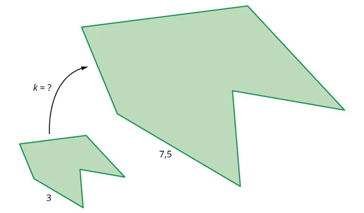

**Principe**

Pour calculer le coefficient d'agrandissement ou de réduction $k$, on cherche par quel nombre ont été multipliées les longueurs de la figure initiale pour obtenir la figure agrandie ou réduite.

**Exemple**

Dans la figure ci-dessous, on cherche le coefficient d'agrandissement.

On voit que $3 \times k = 7{,}5$. On en déduit : $k = \dfrac{7{,}5}{3}=2{,}5$. C'est le coefficient d'agrandissement.
