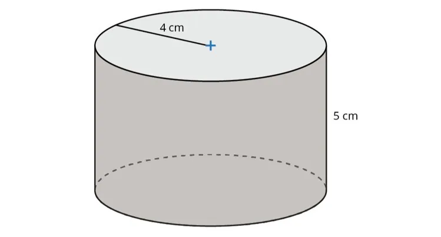

**Principe**

Pour calculer le volume d'un cylindre dont on connaît le rayon $R$ et la hauteur $h$, on applique la formule : $V_\text{cylindre} = \pi \times R^2 \times h$.

**Exemple**

Le volume du cylindre ci-dessous se calcule ainsi : $V_\text{cylindre} = \pi \times R^2 \times h \approx 3{,}14 \times 4^2 \times 5 = 251{,}2~\text{cm}^3$.

**Remarques**

- Le nombre $\pi$ (« pi ») est une constante dont une valeur approchée est 3,14.
- Le rayon d'un cercle est la moitié de son diamètre.
- Il existe de nombreuses unités de volume : cm³, m³, km³, L…
