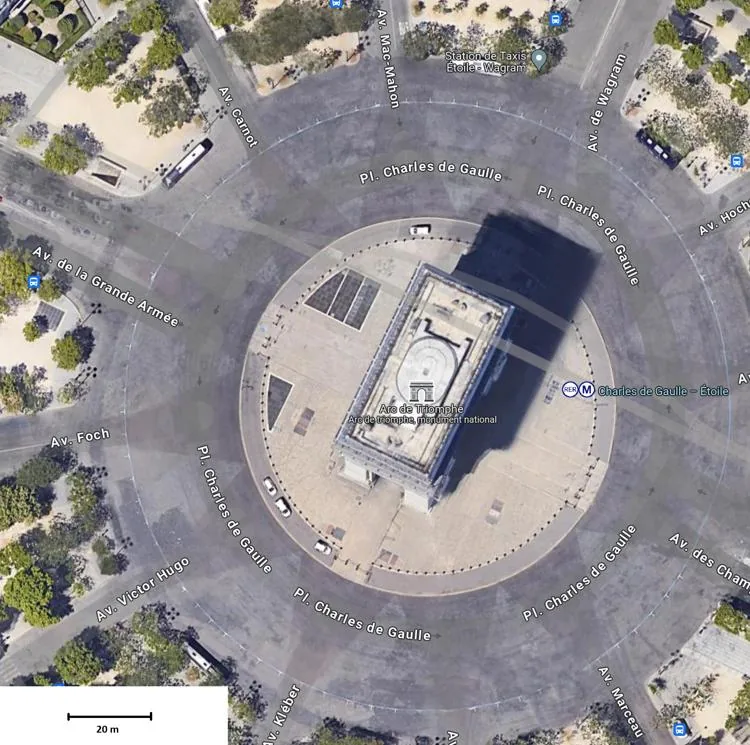

On souhaite estimer la longueur et la largeur de l'Arc de triomphe à l'aide de la photo satellite ci-dessous.

1. À l'aide d'une règle, mesurer la longueur du segment d'échelle, dans le coin inférieur gauche.

2. À 1 cm sur l'écran, quelle longueur réelle correspond-il ?

3. En déduire la largeur et la longueur de l'Arc de triomphe.
