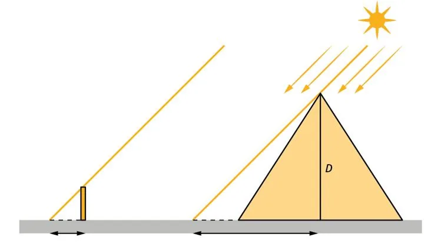

Le pharaon Ahmôsis était très fier de sa dernière pyramide. Il prétendait qu'elle était si haute qu'il était impossible d'en mesurer la hauteur. Thalès releva le défi : il planta un bâton d'une hauteur de 1,5 m (longueur $A$) et mesura son ombre : $B$ = 4,8 m.

Ensuite, il mesura la partie de l'ombre de la pyramide qui dépassait de celle-ci. Il ajouta à cette longueur la demi-base pour obtenir l'ombre totale de la pyramide (longueur $C$). Il obtint une longueur totale de 144 m.

1. À partir des données de l'énoncé, préciser à quoi correspondent les longueurs $A$, $B$ et $C$ sur le schéma.

2. Trouver le coefficient d'agrandissement $k$ permettant de modéliser le passage du petit triangle formé par le bâton et son ombre au grand triangle formé par le sommet de la pyramide et son ombre.

3. En déduire la hauteur de la pyramide.
