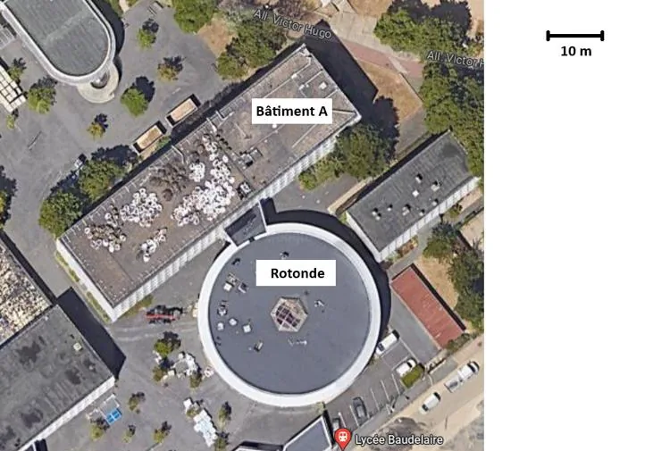

La région Île-de-France souhaite rénover la toiture du lycée Baudelaire. Dans un premier temps, elle réalise une estimation de la surface de toiture à étancher. La partie à rénover est composée de deux bâtiments :

- le bâtiment A de forme rectangulaire ;
- la rotonde de forme circulaire.

1. Mesurer la largeur et la longueur du bâtiment A, le rayon de la rotonde et la longueur du segment d'échelle.

2. Calculer la surface du bâtiment A sur l'image, ainsi que la surface de la rotonde.

   ::: coup-de-pouce m-aire-disque
   :::

3. Calculer l'échelle de la photo. En déduire le coefficient d'agrandissement $k$ entre la taille du lycée sur la photo et ses dimensions réelles.

4. En déduire l'aire réelle de la surface de toiture à étancher.
