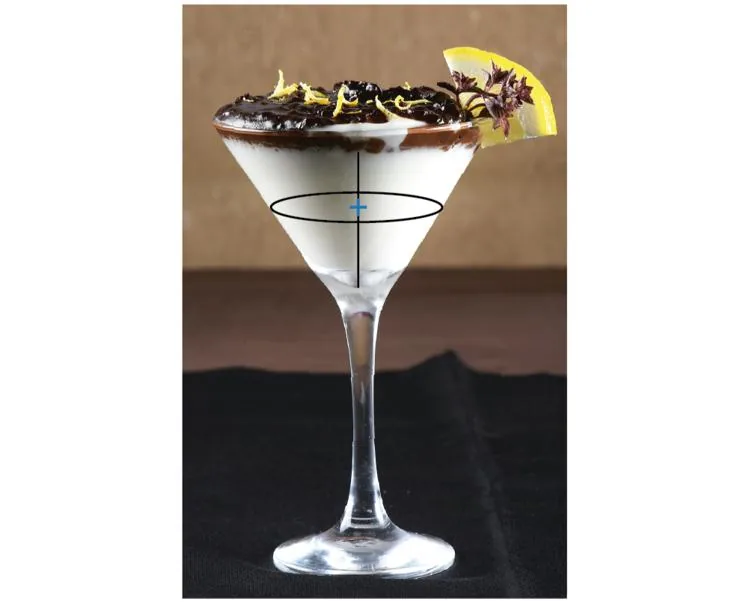

Issa travaille dans l'hôtellerie-restauration et s'intéresse au design des verres à verrine d'une contenance de 24 cL. Il remarque qu'avec ce type de verre, le niveau du dessert ne descend pas de manière régulière.

1. Quelle figure permet de modéliser la forme de la partie haute du verre ?

2. Quel volume de crème contient ce verre ?

3. Lorsque la hauteur de crème a baissé de moitié, la crème restante forme une réduction du verre initial. Calculer le coefficient $k$ de cette réduction.

4. Calculer alors le volume de crème restante.

5. Lorsque la hauteur de crème a diminué de moitié, quel pourcentage de crème a été consommé ?
