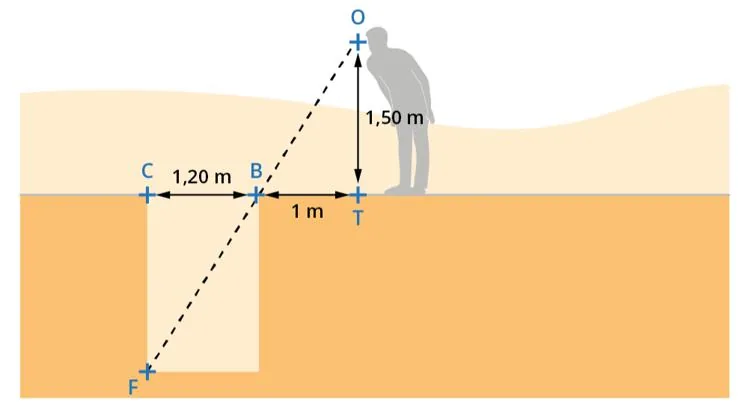

Dans la Grèce antique, on trouve des traces d'une méthode permettant de calculer la profondeur d'un trou sans avoir ni à descendre dedans, ni à transporter un long bâton. Il suffit de fermer un œil, puis de s'approcher du trou jusqu'au point où on commence juste à voir le fond du trou (un rayon lumineux venant de F passe par le bord du trou en B avant d'arriver à l'œil en O).

On note alors différentes mesures comme sur le schéma suivant.

1. Sur le schéma, surligner les triangles OBT et CBF.

2. Pourquoi peut-on dire que l'un de ces triangles est un agrandissement de l'autre ?

3. Calculer le coefficient d'agrandissement.

4. En déduire la longueur CF.

5. Proposer un mode d'emploi permettant de mesurer la profondeur de n'importe quel trou à l'aide de cette méthode.
